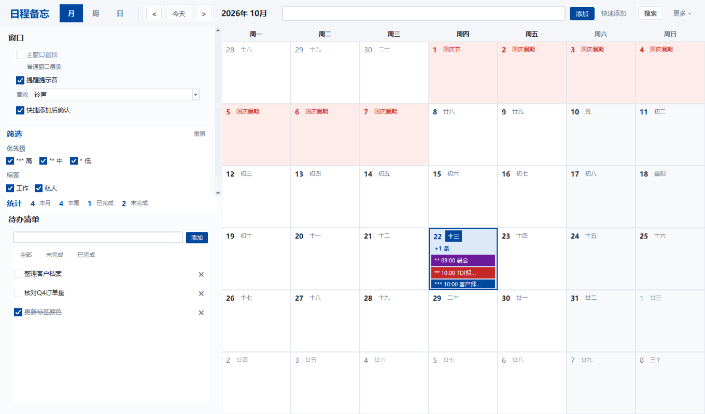
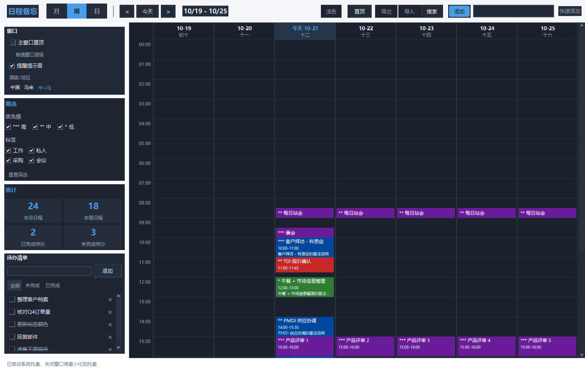
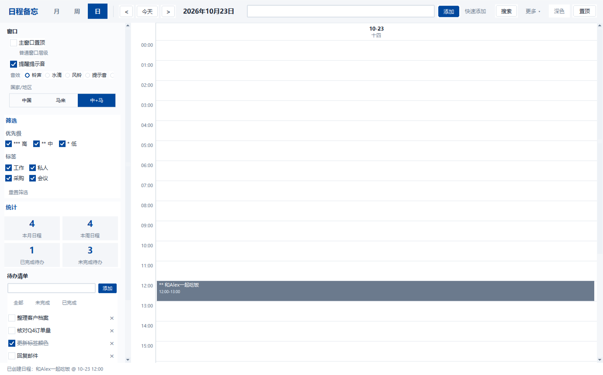

# 日程备忘（Calendar Memo）

一款运行在 Windows 上的**纯本地离线**日历备忘录桌面应用。
Python + Tkinter 实现，无需任何云服务，所有数据仅保存在本机，**不发起任何网络请求**。

## 界面预览

**月视图**（默认首页，日期格直接显示日程色块 + 农历 + 节假日）



**周视图 · 深色主题**（时间轴布局，表头显示农历，今日红线）



**日视图**（单日时间轴，色块按标签着色）



---

## 〇、先回答两个常见疑问

### Q1：日程数据存在哪里？会新建 data 文件夹吗？

**会。** 程序首次运行时会自动在**程序所在目录**下创建 `data` 文件夹：

```
<程序所在目录>/
├── 日程备忘.exe
└── data/                      ← 自动创建
    ├── events.json            日程数据
    ├── todos.json             待办数据
    ├── tags.json              标签与颜色
    ├── config.json            配置（置顶状态 / 主题 / 音效 / 窗口位置）
    ├── reminder_state.json    提醒已触发记录
    └── holidays.json          节假日数据（可选，用于覆盖内置表）
```

- 所有数据**只存在这一处**，删掉 `data` 文件夹即等于恢复出厂设置。
- 若程序放在**无写权限**的目录（如 `C:\Program Files`），会自动降级到 `%APPDATA%\CalendarMemo\`。
- 备份 = 直接复制整个 `data` 文件夹。

### Q2：把这个 exe 复制给别人，对方能用吗？

**能，直接复制 exe 就行**，对方电脑无需安装 Python。

但有三点要注意：

| 事项 | 说明 |
|---|---|
| **只复制 exe，不要连 `data` 一起复制** | `data` 里是你的私人日程。一起复制过去，对方会看到你的日程。对方第一次运行会在自己目录下新建一个空的 `data`。 |
| **建议放到桌面或文档目录** | 放 `C:\Program Files` 会因权限问题自动改用 `%APPDATA%`，数据位置和预期不同。 |
| **Windows 可能弹"未知发布者"** | 打包的 exe 没有数字签名。点「更多信息」→「仍要运行」即可。若对方公司有杀软策略可能被拦截。 |

**想把日程一起分享给同事？** 用程序内置的「导出」功能生成 `.json` 备份文件，再让对方用「导入」功能导入（可选合并或覆盖）。这比直接复制 `data` 文件夹更安全可控。

---

## 一、整体架构

```
calendar_memo/
├── main.py                     程序入口（创建 Tk 前先声明 DPI 感知）
├── build_exe.py                PyInstaller 打包配置
├── requirements.txt            依赖清单
├── test_core.py                核心逻辑自测（70 项）
├── test_calendar.py            农历与节假日专项测试（76 项）
├── test_layout.py              重叠日程并排布局测试（22 项）
├── test_resize.py              界面缩放适配测试（25 项）
├── test_dialog.py              弹窗行为回归测试（27 项）
├── test_gui.py                 GUI 冒烟测试（32 项）
├── docs/                       界面截图
└── app/
    ├── config.py               路径解析、常量、主题/优先级/重复规则定义
    ├── models.py               数据模型（Event / Todo / Tag）
    ├── storage.py              JSON 持久化 + 原子写入 + 损坏容错
    ├── lunar.py                农历转换（1900 - 2126，含干支生肖）
    ├── holidays.py             节假日算法（中国 + 马来西亚，百年范围）
    ├── recurrence.py           重复规则展开引擎（母日程 + 按需展开）
    ├── nlp.py                  自然语言快捷添加解析器
    ├── reminder.py             提醒调度引擎（后台线程）
    ├── sound.py                提示音（多音效合成，无外部音频文件依赖）
    ├── markers.py              快捷输入的显式标记语法（#标签 !优先级 @日期 ~时长）
    ├── dpi.py                  Windows 高 DPI 感知与缩放
    ├── topmost.py              窗口置顶（ctypes 调用 Win32 API）
    ├── tray.py                 系统托盘（pystray，可选依赖 + 优雅降级）
    ├── themes.py               浅色 / 深色主题与 ttk 样式
    └── ui/
        ├── main_window.py      主窗口：组装侧边栏 + 视图区 + 工具栏
        ├── month_view.py       月视图（7×6 网格，含农历与节假日）
        ├── time_grid.py        周视图 / 日视图（时间轴，复用同一组件）
        ├── layout.py           重叠日程列分配算法（左右并排）
        ├── event_dialog.py     新建 / 编辑日程表单
        ├── event_detail.py     日程详情 + 重复项作用域询问
        ├── reminder_popup.py   强制置顶提醒弹窗
        ├── todo_panel.py       待办清单面板
        ├── filter_panel.py     筛选面板 + 统计小面板
        ├── search_panel.py     全局搜索
        ├── tag_manager.py      标签与颜色管理
        ├── rounded_button.py   圆角按钮组件（Canvas 自绘）
    ├── typography.py       全局字体字号规范（档位 + 间距常量）
        ├── toggle.py           圆角勾选框 / 单选框组件（Canvas 自绘）
        ├── dialog_base.py      安全模态弹窗基类
        └── tooltip.py          悬浮提示
```

### 分层设计

| 层 | 职责 | 关键特点 |
|---|---|---|
| **数据层** `models / storage` | 模型定义、JSON 读写 | 原子写入（先写 `.tmp` 再替换）；文件损坏自动备份并重建空数据；配置与业务数据分文件 |
| **逻辑层** `lunar / recurrence / nlp / reminder / holidays` | 农历换算、重复展开、文本解析、提醒调度、节假日 | 纯函数为主，不依赖 Tk，可独立测试 |
| **服务层** `dpi / topmost / tray / themes` | 平台相关能力 | Win32 API 封装；可选依赖缺失时自动降级 |
| **界面层** `ui/*` | 视图与交互 | 视图只负责渲染，数据由主窗口统一下发 |

### 依赖包清单

| 包 | 用途 | 是否必需 |
|---|---|---|
| `tkinter` | 图形界面 | 必需（Python 官方自带，Windows 版默认包含） |
| `winsound` | 提醒提示音 | 必需（Windows 内置） |
| `ctypes` | 窗口置顶（Win32 API） | 必需（标准库） |
| `pystray` + `pillow` | 系统托盘图标 | **可选**，缺失时降级为"关闭即退出" |
| `pyinstaller` | 打包 exe | 仅打包时需要 |

---

## 二、功能实现情况

### 🔴 强制基础功能（全部实现）

| # | 功能 | 实现说明 |
|---|---|---|
| 1 | 月/周/日三视图 + 日程标题直接展示 | 月视图 7×6 网格，每格最多显示 3 条日程色块（超出显示"+N 条"，点击进入日视图看全部）；周/日视图为带时间轴的日程块布局 |
| 2 | 新建日程表单 | 点击日期格 → 弹出表单，含标题、备注、开始/结束日期时间、提醒开关 |
| 3 | 到期提醒弹窗 | **独立后台线程**（15 秒轮询），不依赖主窗口是否在前台；弹窗强制置顶（Tk `-topmost` + Win32 `SetWindowPos(HWND_TOPMOST)`，并每 1.5 秒重申）；含标题+备注；三个按钮：关闭 / 稍后提醒 10 分钟 / 稍后提醒 30 分钟 |
| 4 | 日程查看/编辑/删除 | 点击日程条目 → 详情弹窗 → 编辑 / 删除；重复日程会询问「修改全部重复项 / 仅此条」 |
| 5 | 本地 JSON 持久化 | `data/` 目录下独立文件，程序关闭不丢数据 |
| 6 | 窗口置顶开关 | 工具栏按钮 + 侧边栏复选框双入口；按钮文案在「置顶 / 已置顶」间切换并变色；状态写入 `config.json`，**下次启动自动恢复**；关闭置顶恢复普通层级；**提醒弹窗不受此开关影响，始终强制置顶** |

### 🟢 增强功能（全部实现）

| # | 功能 | 实现说明 |
|---|---|---|
| 1 | 标签分类 + 自定义颜色 | 标签管理面板（新增/删除/预设色板/自定义取色），日程色块按标签着色 |
| 2 | 重复日程 | 不重复/每天/每周(可选周几)/每月/每年，支持重复截止日期；**编辑母日程可选择是否同步修改全部重复项**；支持单次例外（仅改/仅删某一次） |
| 3 | 提前提醒设置 | 准时/提前5/15/30分钟/1小时/1天，**一条日程可同时设置多条提醒** |
| 4 | 待办清单模式 | 独立面板，勾选完成/取消，完成项灰色+删除线，筛选【全部/未完成/已完成】 |
| 5 | 全局搜索 | 搜索日程标题、备注、待办内容；结果列表双击定位到对应日期并打开详情 |
| 6 | 导出 / 导入 | 导出 JSON 备份；导入时可选【合并导入 / 覆盖原有数据】。收纳在工具栏「更多 ▾」菜单中（低频功能不占主界面空间） |
| 7 | 系统托盘 | 关闭窗口最小化到托盘，后台继续监听提醒；右键菜单：打开主界面 / 切换置顶状态 / 退出程序。**未安装 pystray 时自动降级**（关闭窗口改为询问退出，状态栏给出提示） |
| 8 | 节日 / 休息日标记 | **中国 + 马来西亚**双套节假日，算法生成覆盖 1900-2126；日历格显示节日名 / 调休「班」字；**农历显示**（初一显示月份名，其余显示日名）；侧边栏可切换国家/地区 |
| 9 | 优先级 | 高`***` / 中`**` / 低`*` 三档，色块标题前带符号；筛选面板可按优先级过滤 |
| 10 | 暗色 / 浅色主题 | 一键切换，界面整体重新构建以完整换肤 |
| 11 | 快捷添加（自然语言） | 双轨制：① **自然语言**（"明天下午3点开会""本周五中午和Alex一起吃饭""10:00-11:30 项目评审""每天9点打卡"）② **显式标记**（`#标签` `!高` `@10-28` `~90`）零歧义。侧边栏开关「快捷添加后确认」：开启则解析后弹出表单预填，确认无误再保存（默认）；关闭则直接创建 |
| 12 | 统计小面板 | 本月日程数、本周日程数、已完成/未完成待办数 |

### 节假日与农历的数据来源

| 数据 | 覆盖范围 | 来源与精度 |
|---|---|---|
| **农历换算** | 1900 - 2126 | 1887-2111 为权威查表数据（已与 Microsoft ChineseLunisolarCalendar 对照实现**逐日比对 82880 天，0 差异**）；2112-2126 为天文算法补齐 |
| **中国节假日** | 1900 - 2126 | 算法生成：法定假日按农历/公历规则推算，传统节日由农历精确换算；**调休上班日**为硬编码（行政安排无法算法推算），已收录 2025-2027 |
| **马来西亚节假日** | 1900 - 2126 | 固定公历假期 + 复活节（Anonymous Gregorian 算法，精度 0 误差）+ 回历节日（算术伊斯兰历，误差 0-2 天）+ 柔佛州大伯公节 |
| **外部覆盖** | 任意 | 把 `holidays.json` 放进 `data/` 即可覆盖内置数据（格式见下） |

```json
{
  "holidays": {
    "2027-01-01": { "name": "元旦", "type": "holiday" }
  },
  "workdays": {
    "2027-02-06": "春节调休"
  }
}
```

- `type` = `holiday` 表示放假日（标红显示名称）
- `workdays` 中的日期表示调休上班日（显示「班」字）

### ⌨️ 快捷输入语法详解

工具栏右侧的「快速添加」输入框支持两类写法，可自由组合：

**① 自然语言时间**（无需记符号）

| 输入 | 解析结果 |
|---|---|
| `明天下午3点开会` | 明天 15:00 |
| `本周五中午和Alex一起吃饭` | 本周五 12:00 |
| `28号下午2点拜访客户` | 本月 28 号 14:00（已过则顺延到下月） |
| `下月28号` / `月底` / `月初` | 下月 28 号 / 本月底 / 下月初 |
| `10:00-11:30 项目评审` | 当天 10:00-11:30 |
| `晚上8点半聚餐` | 20:30 |
| `3天后` / `下周一` / `每周一` | 相对日期 / 重复规则 |
| `紧急 客户来电` | 优先级 = 高（"重要/紧急/关键/低优先级/不急"同理） |
| `工作标签 开会` | 标签 = 工作 |

**② 显式标记**（零歧义，推荐用于结构化信息）

| 标记 | 含义 | 示例 |
|---|---|---|
| `#标签` | 指定标签 | `#工作 客户回访` |
| `!高` `!中` `!低` | 指定优先级 | `!高 #工作 客户回访` |
| `@日期` | 指定日期 | `@10-28` `@明天` `@下周一` |
| `~时长` | 指定时长 | `~90`（分钟）`~1.5h` `~2小时` |

组合示例：`#工作 !高 @10-28 ~1.5h 客户回访`
→ 10-28 14:00 起 90 分钟，标签"工作"，优先级高。

**解析优先级**：显式标记 > 自然语言。两者冲突时以显式标记为准。

**「快捷添加后确认」开关**（侧边栏）
- **开启（默认）**：解析后弹出完整表单并**预填**所有识别结果，确认无误点「保存」才写入 —— 避免自然语言歧义导致时间写错
- **关闭**：解析成功后直接创建并跳转到该日程所在日期（更快，但无误判保护）

**关于识别能力的边界**：本功能采用**纯规则**实现（正则 + 词表），**不引入任何模型或外部依赖**，对安装包体积影响 < 0.1%。代价是中文表达千变万化，无法做到 100% 覆盖所有说法 —— 因此：
- 结构化信息（标签/优先级/日期/时长）建议用**显式标记**，零歧义
- 自然语言时间表达覆盖了高频场景，个别说法解析不准时，用显式标记或完整表单兜底

### 🔵 UI & 交互规范

**布局**
- 左侧边栏（置顶开关 + 音效 + 地区 + 筛选 + 统计 + 待办）+ 右侧主区域（月/周/日）
- **侧边栏整体可滚动**：窗口变矮时不会把待办清单压没，可用滚轮上下浏览
- 工具栏采用 **grid 弹性布局**：左区（标题/视图/导航）固定、中区（快速添加）自动伸展、右区（搜索/更多/主题/置顶）固定 —— 窗口无论宽窄，按钮都不会被裁掉

**控件样式**
- **圆角按钮**（Canvas 自绘，主色 `#00489D`），5 种变体：primary / secondary / ghost / danger / success
- **圆角勾选框**（`app/ui/toggle.py` 自绘）：圆角方框 + 勾号；单选则为圆形 + 内点。已全局替换掉 Windows 传统方框
- 地区切换用**带边框的分段控件**（外层描边 + 选中项高亮）
- 音效选择用**下拉框**：节省侧边栏纵向空间，展开即可看到全部 6 个选项

**字体与排版规范**（`app/ui/typography.py`）

界面里**同层级用同一字号**，业务代码不再出现字号魔法数字：

| 档位 | 字号 | 用途 |
|---|---|---|
| DISPLAY | 17 | 强视觉元素（已少用） |
| H1 | 14 | 弹窗主标题 |
| H2 | 11 | 区块标题（LabelFrame 标题、"筛选"/"统计"） |
| H3 | 10 | 次级小标题 |
| BODY | 10 | 正文 |
| SMALL | 9 | 辅助说明 |
| CAPTION | 8 | 极小标注 |

- 分组框统一用 `typography.group_frame()`：标题 H2、标题靠左上（`labelanchor="nw"`）、内边距一致
- 间距统一走 `SECTION_GAP`（区块间 10）/ `ITEM_GAP`（条目间 4）
- 所有字号随 DPI 自动缩放

**侧边栏三段式布局**
- 上半段（窗口设置 / 筛选）：可滚动，内容多时自己滚
- 中段（统计条）：**常驻**，任何窗口高度下都可见
- 下半段（待办清单）：**常驻底部**，永远可见不必滚动

**交互**
- 提醒弹窗强制置顶；提示音可在侧边栏开关并**切换音效种类**
- 月视图**鼠标滚轮切换月份**，工具栏左右箭头切换月份/周/日
- 表单校验：结束时间早于开始时间会拦截并提示；日期格式非法会提示
- 置顶按钮有明确状态反馈：文案变化 + 颜色变化 + 侧边栏显示「已置顶（位于所有窗口顶层）」

**重叠日程并排显示**
- 时间轴视图中同一时间段的多个日程**左右并排**（经典 calendar column packing 算法）
- 互相重叠的日程划入同一冲突组，共享总列数；首尾相接（如 9-11 与 11-13）不算冲突，可复用同一列
- 实现在 `app/ui/layout.py`，22 项专项测试覆盖

**窗口尺寸**
- 窗口**可自由缩放**，默认 1360×800（适配 1366×768 常见笔记本分辨率）
- 尺寸与位置都会被记忆
- 尺寸变化走「拖拽检测 + 防抖 + 抖动检测」三层防护，不会引起界面抖动

**工具栏**
- 只保留高频操作：**添加 / 快速添加 / 搜索 / 更多**
- 低频功能收进「更多」菜单：切换深色/浅色、导入、导出、标签管理、打开数据文件夹
- 置顶开关在侧边栏「窗口」区（勾选框，状态实时生效）

**节假日**
- 固定使用**中国**标准节假日（侧边栏不再提供国家/地区切换）

**缩放性能（防抖动）**

Tkinter 的 `<Configure>` 是**高频信号**，社区通用实践是「把 resize 当热路径，
只在停下来之后做一次重活」。本项目据此做了五层防护：

| 层 | 做法 | 防止的问题 |
|---|---|---|
| 1 | 拖拽检测：200ms 内的连续变化判定为拖拽，期间**完全不重绘** | 拖动时狂闪 |
| 2 | 防抖：`after_cancel` + `after(120)`，连续事件只保留最后一次 | 一次拖拽上百次重绘 |
| 3 | 抖动检测：连续变化幅度 <= 3px 判定为震荡，冻结重绘 | 布局自反馈循环 |
| 4 | **不在 Configure 回调里改布局/尺寸** | 改布局 -> 再触发 Configure -> 死循环 |
| 5 | 统一渲染调度：视图提供 `schedule_render()`，主窗口与视图共用防抖窗口 | 重复渲染 |

> 踩过的坑：第 4 条曾两次违反 —— 一次是月视图的 `_relayout()` 重新 grid 42 个格子，
> 一次是"锁定窗口尺寸"方案在 Configure 回调里调 `geometry()` 拉回尺寸
> （实测一次 resize 触发 **960 次** Configure 回调、耗时 4.8 秒）。
> **在 Configure 回调里改几何 = 自造事件风暴**，这是本项目最核心的教训。

**渲染性能（控件池化）**
- 早前每次重绘都 destroy 重建 42 个格子的全部子控件，单次 render **365ms**
- 现改为：固定结构（日期行等）只创建一次，日程块用**控件池**复用
- 单次 render **57ms**（快 6.4 倍），25 步拖拽从 33 秒降到 11 秒

### 🔔 提醒提示音

侧边栏「音效」一栏可切换，切换时立即试听：

| 音效 | 说明 |
|---|---|
| **铃声**（默认） | 双音交替（880Hz → 1175Hz），柔和不刺耳 |
| 水滴 | 下滑音（1400Hz → 900Hz），短促清脆 |
| 风铃 | 三音上行（988 → 1319 → 1568Hz） |
| 提示音 | Windows 系统声音 `Asterisk` |
| 闹钟 | Windows 系统声音 `Alarm` |
| 静音 | 不发声 |

实现见 `app/sound.py`：**不依赖任何外部音频文件**，用 `winsound.Beep` 合成或调用系统声音别名，跨平台自动降级（静默忽略，不影响提醒功能本身）。选择的音效写入 `config.json` 的 `sound_kind`。

### 🟡 数据与安全

- 纯本地离线，**无任何网络请求**，不接入第三方 API
- JSON 文件损坏时自动备份为 `*.corrupt_<时间戳>` 并新建空数据，程序不崩溃
- 置顶/主题/音效等配置单独存 `config.json`，与 `events.json` 等业务数据分离
- **高 DPI 感知**：启动时声明 Per-Monitor DPI Aware，高分屏下界面清晰不模糊；窗口尺寸按屏幕工作区自适应

---

## 三、运行方法

### 方式一：直接运行源码（开发调试）

```bash
cd calendar_memo
python main.py
```

> Windows 官方 Python 安装包默认包含 tkinter，无需额外安装。

### 方式二：打包为独立 exe（推荐分发）

```bash
cd calendar_memo
pip install -r requirements.txt
python build_exe.py
```

或者使用 PyInstaller 原生命令：

```bash
pyinstaller --noconfirm --clean --onefile --windowed ^
            --name 日程备忘 ^
            --hidden-import pystray._win32 ^
            --hidden-import PIL._tkinter_finder ^
            main.py
```

产物：`dist/日程备忘.exe`（单文件 ~18MB，双击运行，**目标电脑无需安装 Python**）。

> 若需要自定义图标，把 `app_icon.ico` 放到项目根目录，`build_exe.py` 会自动使用。

---

## 四、快捷键

| 快捷键 | 功能 |
|---|---|
| `Ctrl + N` | 快速添加日程（聚焦自然语言输入框） |
| `Ctrl + F` | 打开全局搜索 |
| `Ctrl + T` | 切换窗口置顶 |
| `Ctrl + D` | 切换深色/浅色主题 |
| `Enter`（表单内） | 保存 |
| `Esc` | 关闭窗口/弹窗 |

---

## 五、自测

```bash
python test_core.py       # 核心逻辑 70 项：重复展开/NLP解析/存储容错/提醒引擎
python test_calendar.py   # 农历与节假日 76 项：全量逐日往返/复活节/回历/中马节假日
python test_layout.py     # 重叠并排 22 项：冲突分组/列分配/首尾相接/嵌套
python test_resize.py     # 缩放适配 25 项：按钮不裁/侧边栏可滚/防抖/滚动条按需
python test_quickadd.py   # 快捷添加 47 项：时段词/日期词/三种视图可见性/无标签/高亮
python test_markers.py    # 快捷输入增强 49 项：X号/显式标记/自然语言标签/确认模式
python test_stability.py  # 布局稳定性 9 项：防抖动/尺寸稳定/重绘放大检测
python test_v8.py         # v8 功能 29 项：置顶/工具栏精简/地区移除/窗口锁定/弹窗交互
python test_dialog.py     # 弹窗行为 27 项：尺寸/位置/grab 释放（防锁死回归）
python test_gui.py        # GUI 冒烟 32 项：视图渲染/置顶/主题/表单校验/持久化
```

当前状态：**核心 70 + 日历 76 + 布局 22 + 缩放 22 + 快捷添加 47 + 标记增强 49 + 稳定性 9 + v8 功能 24 + 弹窗 27 + GUI 38 = 384 项全部通过**。

---

## 六、已知限制

1. **托盘功能需要 `pystray` + `pillow`**：未安装时关闭窗口会改为询问退出（状态栏会提示如何启用）。打包 exe 时这两个包会被一并打入，正常分发不受影响。
2. **调休上班日为硬编码**：已收录 2025-2027 三年。后续年份需通过 `data/holidays.json` 补充（接口已预留）。
3. **回历节日误差 0-2 天**：采用算术伊斯兰历，与马来西亚官方公布的日期可能有 1-2 天差异。
4. **月视图每格最多显示 3 条日程**，更多请点击「+N 条」进入日视图查看。
5. 提醒引擎轮询间隔为 15 秒，因此提醒最多会有约 15 秒延迟；启动时超过 60 分钟的过期提醒不再补弹。
